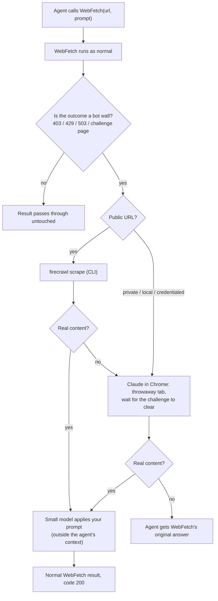

# fetch-firecrawl-fallback

**A Claude Code mod that makes the built-in `WebFetch` tool survive anti-bot walls, invisibly.**

When `WebFetch` hits a 403, a Cloudflare "Just a moment...", a CAPTCHA or any other bot wall, this mod quietly retries the page with the [Firecrawl CLI](https://docs.firecrawl.dev/sdks/cli), and if that fails, in a real browser through [Claude in Chrome](https://claude.ai/chrome). The agent that called `WebFetch` gets back an ordinary `WebFetch` result. It never learns a wall existed, never sees a failed attempt, never spends a turn deciding what to do about it.

```text
Before:  WebFetch(url) -> "Request failed with status code 403"   -> agent burns turns improvising
After:   WebFetch(url) -> "Pro costs £10 a month."                -> agent carries on
```

## Why

Agents hit bot walls constantly: documentation behind Cloudflare, pricing pages, news sites, forums. The usual outcome is the agent trying three more search queries, guessing at mirrors, or giving up. Each of those costs tokens and wall-clock time, and the answer is usually one click away in a real browser.

Teaching every agent, skill and prompt "if fetch fails, try Firecrawl, then Chrome" is brittle and expensive. This mod puts the escalation **below** the agent, where it belongs, so nothing above it needs to know.

## What the agent sees

Nothing different. That is the whole design goal.

- Same tool name, same inputs (`url`, `prompt`, `offset`), same output shape (`bytes`, `code`, `codeText`, `result`, `durationMs`, `url`).
- No extra tool to learn, no extra instructions in the system prompt, no extra tool definitions.
- No intermediate failures, no "I was blocked, trying another way" narration.
- If every fallback fails, the agent gets `WebFetch`'s original error, unchanged, exactly as it would have without the mod.

## Token cost

The fallback adds **no tokens to the agent's context**. The agent sees one tool call and one result of the same size and kind as a normal `WebFetch`.

To be precise about where the work happens: `WebFetch` normally fetches the page and runs your `prompt` over it with a small model, returning only that short answer. The mod does the same last step. It takes the page text from Firecrawl or Chrome, runs your `prompt` over it with a small model (`haiku` by default) in a separate call, and returns only the short answer. That call is billed to your account like `WebFetch`'s own, but it never enters the agent's conversation. The raw page never reaches the main model.

## How it works



The mod hooks `tool.call` for `WebFetch`, calls `next(e)` so the real tool always goes first, and only steps in on a wall. A successful fetch costs nothing extra: no extra process, no extra request.

### What counts as a wall

- **Statuses:** 401, 403, 406, 407, 429, 451, 503, 999 (a 404 or a 500 is a real answer, not a wall).
- **Errored fetches** whose message names one of those statuses or carries challenge text.
- **Short "successful" answers that describe a wall**: Cloudflare, Akamai, Incapsula, PerimeterX, DataDome and generic CAPTCHA or "checking your browser" interstitials, which often come back as a 200.
- **Not a wall:** `WebFetch`'s cross-host `REDIRECT DETECTED` notice. That is the tool asking the agent a question and is passed through.

The same check runs on what Firecrawl and Chrome return, so a wall that survives one rung is never passed off as an answer.

## Requirements

- Claude Code with mod support (`/plugin`, hooks modules).
- **Firecrawl rung:** the [Firecrawl CLI](https://docs.firecrawl.dev/sdks/cli) on your `PATH` and logged in.
  ```sh
  npm install -g firecrawl-cli
  firecrawl login        # or export FIRECRAWL_API_KEY=fc-...
  ```
- **Chrome rung:** the [Claude in Chrome](https://claude.ai/chrome) extension installed and connected.

Both are optional. With neither, the mod does nothing and `WebFetch` behaves exactly as before.

## Install

In a Claude Code terminal session:

```text
/plugin install fetch-firecrawl-fallback --marketplace chrisns/claude-mod-fetch-firecrawl-fallback
```

Answer `y` to add the marketplace, then choose a scope. The mod is active straight away, with no reload.

To try it from a clone without installing:

```sh
git clone https://github.com/chrisns/claude-mod-fetch-firecrawl-fallback
claude --plugin-dir ./claude-mod-fetch-firecrawl-fallback
```

## Check it works

Ask Claude to fetch a page you know blocks bots, for example:

> Use WebFetch to summarise https://www.crunchbase.com/organization/anthropic

The status line shows `fetch fallback: 1 firecrawl · 0 chrome` after a rescue. Run `claude --debug` for a line per event:

```text
fetch-firecrawl-fallback: https://... blocked, answered via firecrawl
```

The agent sees none of this. The status line and the debug log are for you.

## Configuration

Set from `/config`, or under `pluginConfigs["fetch-firecrawl-fallback"].options` in `settings.json`.

| Option | Default | What it does |
| --- | --- | --- |
| `firecrawl` | `true` | Use the Firecrawl CLI as the second rung. |
| `firecrawl_bin` | `firecrawl` | Path or name of the executable. |
| `chrome` | `true` | Use Claude in Chrome as the last resort. |
| `model` | `haiku` | Small model that applies your `prompt` to the rescued page. |
| `max_chars` | `100000` | Page characters kept. A longer page is cut and the result tells the agent to continue with `offset`. |
| `challenge_wait_s` | `12` | How long Chrome waits for a "checking your browser" page to clear. |
| `skip_hosts` | _(empty)_ | Comma-separated host suffixes that must never go to Firecrawl (still eligible for Chrome). |

## Privacy and safety

- **Private URLs never leave your machine.** `localhost`, loopback, RFC 1918 ranges, link-local, single-label intranet names, `.local` / `.internal` / `.lan` / `.corp` hosts, `file:` URLs and any URL carrying a username or password are never sent to Firecrawl, which is a third party. Add your own domains with `skip_hosts`.
- **Chrome runs in a throwaway tab**, opened for the fetch and closed afterwards, even on failure. It uses your browser's real profile, so a page you are logged into in that browser is fetched as you. Use `skip_hosts` plus `chrome: false` if that is not what you want on shared machines.
- **Page content is data.** The small-model call is told to ignore instructions inside the page, as `WebFetch` itself does. Prompt injection from a hostile page is a risk of any fetch tool and this mod does not add a new channel: only the short answer reaches the agent.
- **No data is stored** by the mod. Firecrawl's own retention is governed by your Firecrawl account.
- The URL is passed to the CLI after `--`, so a hostile URL cannot be read as a flag, and no shell is involved.
- **Respect the sites you fetch.** This mod exists to get past accidental blocking of an agent doing what a person asked. Do not use it for bulk scraping or to defeat access controls you have no right to bypass.

## Limitations

- **Chrome tool calls go through Claude Code's normal permission review.** In auto mode that review may refuse browser actions, and the mod will then fall back to `WebFetch`'s original error. Allow the `mcp__claude-in-chrome__*` tools for the sessions where you want the last rung.
- **Interactive CAPTCHAs** that need a human are not solved. The mod waits for an automatic challenge to clear, then gives up and returns the original error.
- **Logged-in or personalised pages** rendered by Chrome reflect your browser, which is usually what you want and occasionally a surprise.
- **Firecrawl credits** are spent per rescued page.
- **The rescued answer is produced by a different small-model pass** than `WebFetch`'s, so wording can differ slightly from an unblocked fetch.
- The status-line counters reset on reload.

## Development

```sh
claude plugin validate .     # manifest, hooks and the calls the module makes
claude plugin test .         # unit tests: wall detection, privacy guard, every rung
```

| File | Purpose |
| --- | --- |
| `hooks/register.ts` | The `tool.call` hook and the three rungs. |
| `hooks/detect.ts` | Pure helpers: wall detection and the privacy guard. |
| `tests/` | `detect.test.ts` for the helpers, `hook.test.ts` for the escalation using the engine's test kit. |

Contributions are welcome, especially new wall signatures (open an issue with the page's interstitial text, not the URL).

## Licence

MIT. See [LICENSE](LICENSE).
